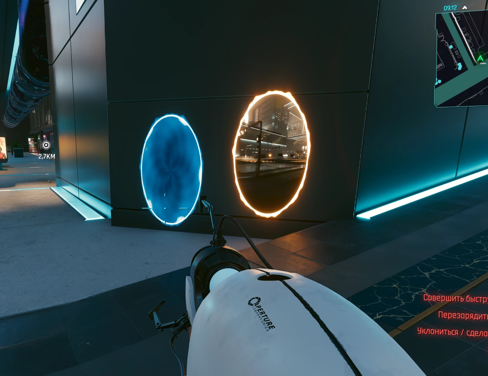
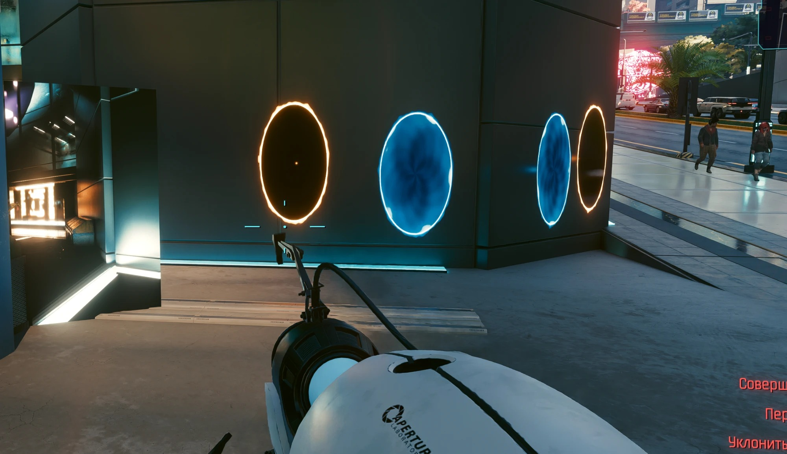
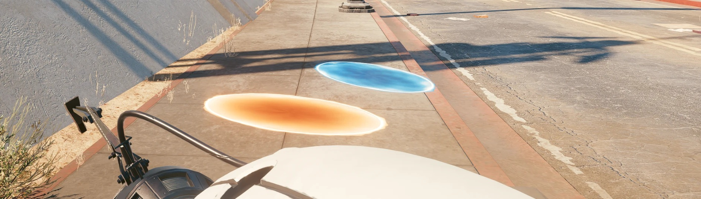

# Portal Gun for Cyberpunk 2077

The Aperture Science Handheld Portal Device in Night City: shoot a blue and an orange portal onto walls, floors and
ceilings, look through one and see out of the other, walk in and come out of the other side, and send NPCs through.

**Download:** the ready-to-install archive is in
[Releases](https://github.com/perseval-BLR/Cyberpunk2077-Portal-Gun/releases/latest) (Nexus Mods page coming soon).
This repository holds the source code and configuration; the 3D model and textures ship only in the archive.

> **Fan-made, non-commercial.** Not affiliated with or endorsed by Valve or CD PROJEKT RED. See
> [Disclaimer](#disclaimer) and [CREDITS](CREDITS.md).



| | |
|---|---|
|  |  |

## Features
- **A new weapon** in your inventory: the portal gun (HD Portalgun Remastered model) with its own icon, name and
  description (English, Russian). It is added a few seconds after you load a save.
- **Left mouse: blue portal, right mouse: orange portal.** A glowing shot flies from the gun; the portal opens where
  it lands, on any static surface, up to the distance the game has the world loaded around you.
- **Portals look the part:** an animated swirl, a flickering rim of flames, opening from a point with a flash.
- **See-through:** with both portals placed, each one shows a live view out of the other (the game's own
  render-to-texture portal device, re-purposed).
- **Walk through:** a portal pulls you in and pushes you out of the other one at the speed you came in, turned to
  match the portals: fall into a floor portal and fly out of a wall.
- **NPCs go through too:** they go ragdoll, get pulled in and thrown out of the other portal.

## Requirements
Tested with **Cyberpunk 2077 2.31** and these versions (newer ones should work):

| Mod | Tested version | Link |
|---|---|---|
| Cyber Engine Tweaks | 1.37.1 | https://www.nexusmods.com/cyberpunk2077/mods/107 |
| RED4ext | 1.30.0 | https://www.nexusmods.com/cyberpunk2077/mods/2380 |
| redscript (needed by Codeware) | — | https://www.nexusmods.com/cyberpunk2077/mods/1511 |
| ArchiveXL | 1.27.4 | https://www.nexusmods.com/cyberpunk2077/mods/4198 |
| TweakXL | 1.11.5 | https://www.nexusmods.com/cyberpunk2077/mods/4197 |
| Codeware | 1.20.5 | https://www.nexusmods.com/cyberpunk2077/mods/7780 |

Single-player only. No other mods of the author are needed.

## Install
Vortex / MO2: install the archive as usual. Manual: extract it into the game folder (the one with `bin`, `archive`,
`r6`) so that you get:
```
archive/pc/mod/PortalGun.archive
archive/pc/mod/PortalGun.archive.xl
bin/x64/plugins/cyber_engine_tweaks/mods/portalgun/init.lua
r6/tweaks/portalgun.yaml
```

## Controls
| Action | Default |
|---|---|
| Blue portal | left mouse button (portal gun in hands) |
| Orange portal | right mouse button (portal gun in hands) |
| Same with any weapon | CET overlay → Bindings → `portal_blue`, `portal_orange` |
| Remove both portals | CET overlay → Bindings → `portal_clear` |
| Give the gun again | CET overlay → Bindings → `portal_give` |

## Uninstall
Delete the four paths above. The gun disappears from the inventory on the next load.

## Known issues
- **The see-through view works only up to roughly 20 m** from the portal you look at; further away the portal shows
  its swirl. This is a limit of the game's render-to-texture cameras.
- Now and then the view does not come up at once; shooting the portal again brings it back.
- Portals go only onto static surfaces (walls, floors, ceilings of the level), not onto cars or props.
- To move a passer-by through a portal the mod sometimes has to swap them for an identical copy that comes out of
  the other portal. Quest characters are never swapped.
- No sounds yet.
- Log for bug reports: `bin/x64/plugins/cyber_engine_tweaks/mods/portalgun/log.txt`.

## Disclaimer
This is a free fan project made for fun. It is not affiliated with, endorsed or sponsored by Valve Corporation or
CD PROJEKT S.A. *Portal*, the portal gun design and Aperture Science are trademarks and copyrighted works of Valve
Corporation; *Cyberpunk 2077* belongs to CD PROJEKT S.A. The 3D model is used under its Creative Commons license (see
[CREDITS](CREDITS.md)). No money, donations or premium access are tied to this mod.
**Rights holders:** if you want any content removed, open an issue at
https://github.com/perseval-BLR/Cyberpunk2077-Portal-Gun or message perseval-BLR — it will be taken down promptly.

## How it was made
Built by perseval-BLR together with Claude Code (Anthropic, model Claude Opus 5.5): research of the game's scripting
and rendering API (including the game's unused portal device), the portal and teleport logic, the model conversion
(Blender, WolvenKit) and the item files. Code: MIT (see [LICENSE](LICENSE)); third-party assets keep their own terms.

---

# Портальная пушка для Cyberpunk 2077

Портативное устройство для создания порталов «Апертуры» в Найт-Сити: синий и оранжевый порталы на стены, пол и
потолок, вид сквозь портал, проход через него и NPC, которых засасывает в портал и выбрасывает из второго.

- **ЛКМ** — синий портал, **ПКМ** — оранжевый (с пушкой в руках). Заряд летит из пушки, портал открывается там, куда
  он попал.
- **Вид насквозь:** когда стоят оба портала, в каждом видно то, что перед другим (до ~20 м).
- **Проход:** портал втягивает и выталкивает из второго с той же скоростью — упали в портал в полу, вылетели из стены.
- Пушка появляется в инвентаре через несколько секунд после загрузки сохранения (или по клавише CET `portal_give`).

**Требования:** Cyberpunk 2077 2.31, Cyber Engine Tweaks, RED4ext, redscript, ArchiveXL, TweakXL, Codeware — ссылки в
таблице выше. **Установка:** распаковать архив в папку игры. **Удаление:** удалить четыре пути из списка выше.

**Известные ограничения:** вид насквозь — только до ~20 м (ограничение движка); иногда вид появляется не сразу —
помогает выстрелить порталом ещё раз; прохожих мод иногда заменяет копией; звуков пока нет.

**Дисклеймер:** бесплатный фанатский мод, не связан с Valve и CD PROJEKT RED. Portal, портальная пушка и Aperture
Science принадлежат Valve. Модель — по лицензии CC BY 4.0 (см. CREDITS). Правообладатели могут запросить удаление —
контент будет удалён.
